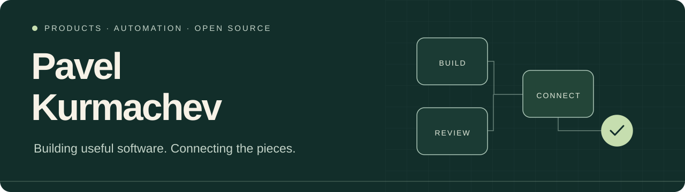

 

I build web and mobile products, MCP integrations, and local AI workflows. My projects range from team workspaces and automated QA to photo journals and Telegram apps.

### Selected projects

<table>
<tr>
<td width="50%" valign="top">
<h3><a href="https://github.com/a1231231123bc/freejira">Freejira</a></h3>

A shared workspace for teams running several projects at once. Kanban, tasks, comments and MCP in one place, with a self-hosted edition.

<code>TypeScript</code> <code>React</code> <code>SQLite</code> <code>MCP</code>

</td>
<td width="50%" valign="top">
<h3><a href="https://github.com/a1231231123bc/freejira-qa">Freejira QA</a></h3>

An always-on worker that checks review tasks against GitHub PRs, runs project tests and uses local models to write QA reports.

<code>Python</code> <code>Ollama</code> <code>GitHub</code> <code>MCP</code>

</td>
</tr>
<tr>
<td width="50%" valign="top">
<h3><a href="https://github.com/a1231231123bc/before">Frameago</a></h3>

An offline photo journal for seeing progress over time. Compare moments, create before-and-after images and export short videos on device.

<code>React Native</code> <code>Expo</code> <code>TypeScript</code>

</td>
<td width="50%" valign="top">
<h3><a href="https://github.com/a1231231123bc/padel-legue">PadelBook</a></h3>

A Telegram Mini App for booking padel courts, with a React interface, Python API and a companion bot.

<code>React</code> <code>FastAPI</code> <code>PostgreSQL</code>

</td>
</tr>
</table>

Also building **[Screen Studio](https://github.com/a1231231123bc/mindmap)** for collaborative screen planning and **[Fin Tracker](https://github.com/a1231231123bc/Fin-Tracker)** for tracking expenses in Telegram.

### Tools I work with

| Interfaces | Services & data | AI & delivery |
| :--- | :--- | :--- |
| TypeScript · React | Node.js · Python · FastAPI | MCP · Ollama |
| React Native · Expo | SQLite · PostgreSQL | Docker · GitHub Actions |

### What ties it together

- **Products you can use:** concrete workflows, clear interfaces and practical defaults.
- **AI connected to real work:** task context, tool access and checks that leave evidence.
- **Control over the setup:** local models, self-hosting and data kept on device where the product calls for it.

---

Explore the repositories for setup instructions, current status and ways to contribute. English / Русский.
